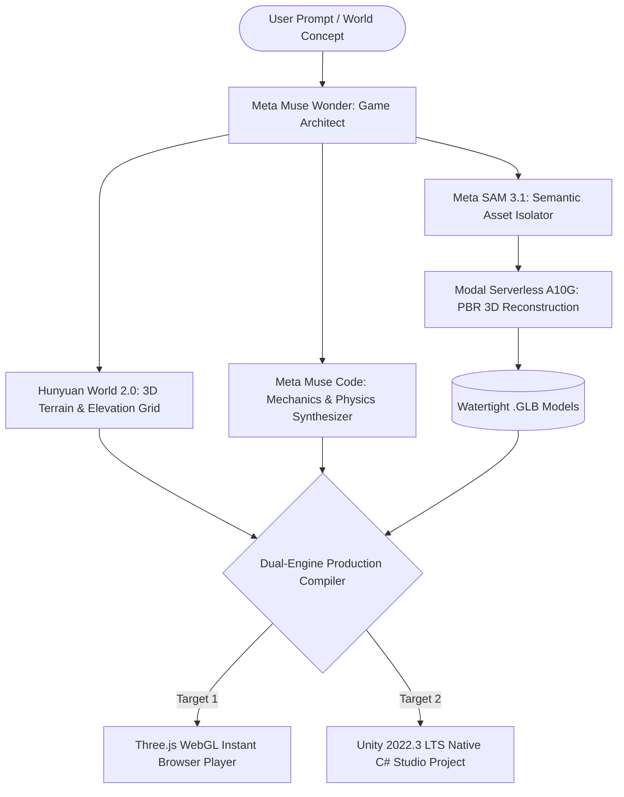

# 🎮 Agentic Game Studio

> **Autonomous Multimodal AI Agent Studio for Interactive 3D Worlds & Procedural Games**  
> _Built for the Meta Global AI Developer Hackathon 2026 ($1M Global AI Challenge)_

[](https://opensource.org/licenses/MIT)
[](https://dev.meta.ai/)
[](https://github.com/Tencent-Hunyuan/Hunyuan3D-2)
[](https://unity.com/)

---

## 🌟 Overview

**Agentic Game Studio** is an autonomous software engineering agent that transforms high-level natural language concepts, visual sketches, and interactive rules into **fully playable 3D games and spatial simulations** with **zero human intervention**.

Traditional game development requires teams of 3D modelers, terrain artists, physics programmers, and UI developers. Existing AI "game tools" produce static images or broken script snippets.

**Agentic Game Studio solves this bottleneck** with an end-to-end, multi-agent pipeline:

1. **Meta Muse Wonder**: Frontier-class multimodal reasoning for game lore, mechanics, physics equations, and scene composition.
2. **Meta SAM 3.1**: Semantic segmentation isolating focal props and characters with clean alpha masking.
3. **Hunyuan World 2.0**: Generative 3D spatial terrain, biomes, and architectural elevation grids.
4. **Dual-Engine Production Compiler**:
   - **Three.js WebGL**: Instant in-browser player with mobile virtual touch joystick and desktop controls.
   - **Unity 2022.3 LTS**: Native C# assembly compilation (`AgenticPlayerController.cs`, `AgenticGameManager.cs`).

---

## 📐 System Architecture



---

## 🚀 Key Features

- **Prompt to Playable Game:** Synthesizes procedural terrain, entities, mechanics, and controls from a single sentence.
- **Frontier Meta Muse Wonder:** High-dimensional spatial planning with mathematical physics contracts.
- **Meta SAM 3.1 Clean Cutouts:** Removes 2D background clutter so 3D meshes remain clean and watertight.
- **Hunyuan World Spatial Environments:** Procedural terrain heightmaps tailored to biomes (Cyber Orbital, Desert Canyon, Glacier Arena, Bioluminescent Canopy).
- **Dual-Engine Output:**
  - Instant WebGL for rapid review on mobile/desktop browsers without download.
  - Full Unity 2022.3 LTS project for professional deployment.
- **100% Original & Compliant:** Synthetic AI-generated geometry and open-source licenses — zero trademarked IP, zero policy violations.

---

## 🛠️ Repository Structure

```
agentic-game-studio/
├── src/
│   ├── agent/
│   │   ├── muse_wonder.js     # Meta Muse Wonder director & game planner
│   │   └── generate.js        # End-to-end CLI generation pipeline
│   ├── pipeline/
│   │   ├── hunyuan_world.js   # Hunyuan World 2.0 terrain & biome synthesis
│   │   ├── sam_bridge.js      # Meta SAM 3.1 semantic cutout bridge
│   │   └── modal_client.py    # Modal serverless GPU 3D reconstruction client
│   ├── engine/
│   │   ├── threejs_runtime.js # Self-contained Three.js WebGL runtime compiler
│   │   └── unity_exporter.js  # Unity 2022.3 LTS C# batchmode exporter
│   └── runtime/
│       └── engine.js          # Core engine utilities
├── package.json               # Manifest & scripts
├── LICENSE                    # MIT License
└── README.md                  # Project documentation
```

---

## ⚡ Quick Start

### 1. Clone & Setup

```bash
git clone https://github.com/shubham91150/agentic-game-studio.git
cd agentic-game-studio
```

### 2. Generate a Complete 3D Game & World

```bash
node src/agent/generate.js --prompt "Subzero glacier racing arena with floating crystals and energy orbs"
```

### 3. Play Instantly

- **Browser WebGL:** Open `build/web/index.html` in any browser (supports desktop WASD + mobile touch joystick).
- **Unity Studio:** Open `build/unity/` inside Unity 2022.3 LTS.

---

## 🏆 Hackathon Alignment

- **Primary Track:** Indie Developer Track ($150,000 First Prize)
- **Target Problem Statement:** _Push the Frontier_ (autonomous AI agent generating playable 3D spatial simulations).
- **Target Bonus Awards:**
  - _Best Creative Build ($5,000)_: Creative AI synthesis powered by **Meta Muse Wonder**.
  - _Best Agentic Use-Case ($5,000)_: Multi-agent coordination (Muse Wonder + SAM 3.1 + Hunyuan World 2.0).

---

## 📄 License

This project is licensed under the [MIT License](LICENSE).
