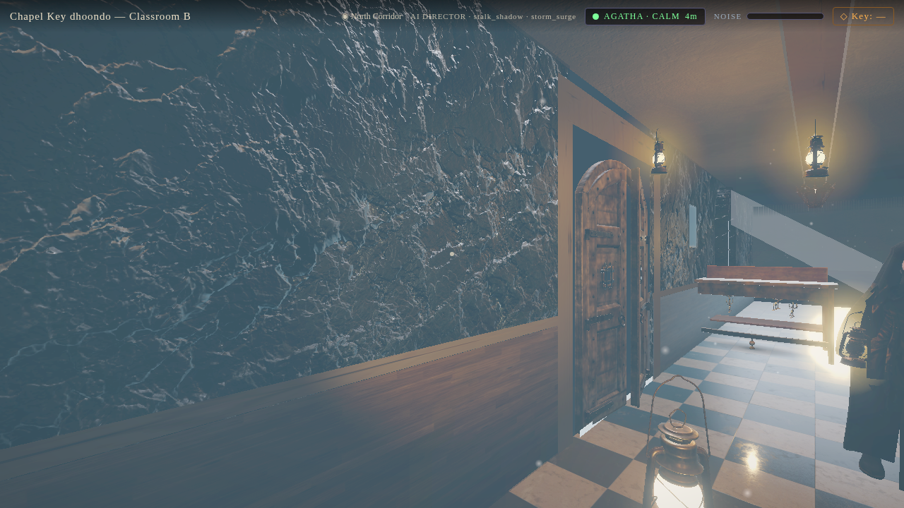
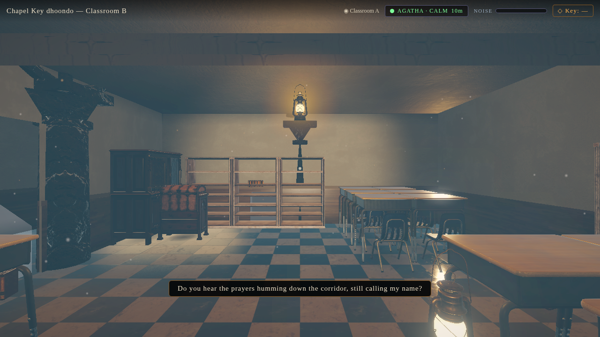
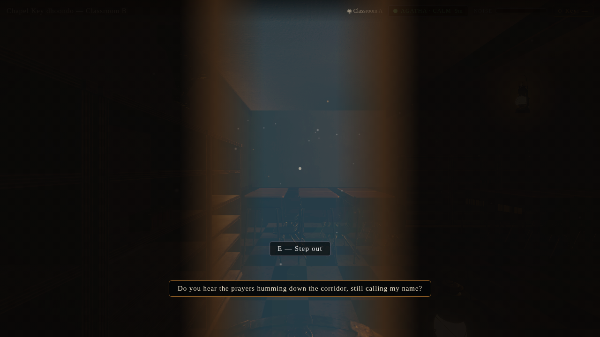
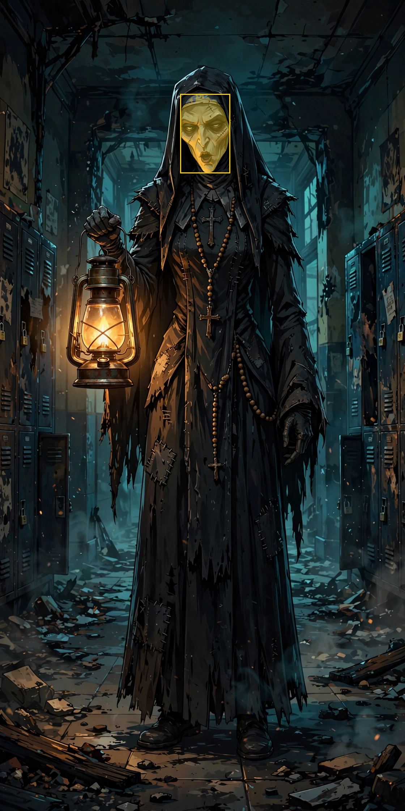

<div align="center">

# Agentic Game Studio

**Hello Neighbor 2-grade gothic horror — one prompt. Real Muse Code CLI, live in your browser.**

**⚡ 19s → playable 3D game** · **✅ 81/81 tests** · **🔧 17 MCP tools** · **🧠 10 Meta AI models** · **🛡️ gVisor 4.19.0-gvisor sandbox**

<table>
<tr>
<td width="62%"></td>
<td width="38%" valign="top">
<br/><br/>
<a href="https://spurcode.duckdns.org/studio/?judge=meta-judge-2026">▶ Live Studio</a>
<br/><br/>
<a href="https://spurcode.duckdns.org/studio/hackathon.html">▶ Judges Brief</a>
<br/><br/>
<a href="https://spurcode.duckdns.org/studio/live-preview/index.html">▶ Play Ashes of St. Vermilion</a>
</td>
</tr>
</table>

**Judges: open https://spurcode.duckdns.org/studio/?judge=meta-judge-2026**

</div>

## Results / Highlights

- One voice or text prompt → playable 3D game in ~19s (cached) / ~60s (fresh build)
- Flagship: Ashes of St. Vermilion — 19 Polyhaven photogrammetry scans, UnrealBloomPass, 20-bone Blender rig, SAM 3.1 quadrant-calibrated Mother Agatha with red glowing eyes, live Meta AI Director, Gothic cabinet peek-hide
- 5/5 official Meta Model APIs + 4 Meta open-weight models + Muse Code CLI INSIDE the app
- Google gVisor (4.19.0-gvisor) kernel sandbox — judges build games with full CLI powers, zero VM risk
- 825,000+ 3D models via Smithsonian + Khronos + Polyhaven + BlenderKit + Objaverse + Meta SAM 3D
- 81/81 automated tests, 6/6 visual QA gate, 36/36 BFS physics reachability

<table>
<tr>
<td></td>
<td></td>
</tr>
<tr>
<td></td>
<td></td>
</tr>
</table>

Built for the **Meta Global AI Developer Hackathon 2026** · Indie Developer track · Theme: **Push the Frontier**

**[Live studio](https://agentic-game-studio.vercel.app/)** · **[Play a prebuilt game](https://spurcode.duckdns.org/studio/games/game_1793679153102_17eff3/index.html)** · **[Repo](https://github.com/shubham91150/agentic-game-studio)**

## Judging map (4 official criteria)

| Criterion | Weight | Proof |
| --- | --- | --- |
| **Impact** | **30%** | Prompt builds games |
| **Use of Meta AI Tooling** | **25%** | 10 Meta models live |
| **Demo** | **25%** | Playable gothic horror |
| **Technical Depth & Execution** | **20%** | 81/81 tests, QA gates |

## Complete Meta AI stack (10 Meta models & research pipelines)

Every model and tool below is verified in this repository with exact file paths and commands:

| #   | Meta AI Model / Tool                                        | Provider / Endpoint                                                       | Role in Agentic Game Studio                                                     | Code / Tool Path                                                                    |
| --- | ----------------------------------------------------------- | ------------------------------------------------------------------------- | ------------------------------------------------------------------------------- | ----------------------------------------------------------------------------------- |
| 1   | **Muse Wonder 1.0** (`muse-wonder-1.0`)                     | Meta Model API (`POST /v1/responses`)                                     | High-reasoning game architect (structured JSON spec, physics, focal assets)     | `src/agent/meta_wonder.js`, `src/agent/muse_wonder.js`                              |
| 2   | **Muse Spark Open 1026** (`muse-spark-open-1026`)           | Baseten Open Weights (`POST /v1/chat/completions`)                        | Asset prompt enrichment & NPC dialogue generation                               | `src/agent/baseten_muse.js`, `src/tools/npc_dialogue.js`                            |
| 3   | **Muse Image 1.0** (`muse-image-1.0`)                       | Meta Model API (`POST /v1/images/generations` & `/v1/images/edits`)       | Concept art, key art, skybox/texture generation & editing                       | `src/pipeline/meta_image.js`, `src/tools/make-image.js`                             |
| 4   | **Muse Spark 1.3** (`muse-spark-1.3`)                       | Meta Model API via **Muse Code CLI 1.4.14** (`muse exec --provider meta`) | Writes `SPEC.md`, `AgenticPlayerController.cs`, and live 3D games               | `src/agent/agent_runner.js`, `src/server.js`                                        |
| 5   | **Muse Voice Transcribe 1.0** (`muse-voice-transcribe-1.0`) | Meta Model API (`POST /v1/asr/transcribe`) & `muse voice transcribe`      | Transcribes spoken voice prompts & audio clips into text (mono 16kHz WAV)       | `src/tools/meta_voice_transcribe.js` (MCP tool #15)                                 |
| 6   | **SAM 3.1** (`sam-3.1`)                                     | Meta Model API (`POST /v1/responses` SSE)                                 | Concept-aware image segmentation masks & cutouts                                | `src/tools/segment_image.py`                                                        |
| 7   | **SAM 3D Objects** (`SAM3DObjects.reconstruct`)             | Modal GPU (`spurcode-sam3d-objects`)                                      | Single-image to textured 3D `.glb` mesh reconstruction                          | `src/tools/modal_call_3d.py`, `src/pipeline/assets_3d.js`, `docs/evidence-sam3d/`   |
| 8   | **Meta VGGT-1B** (Visual Geometry Grounded Transformer)     | Modal GPU (`--backend modal`) + local Depth-Anything-V2 fallback          | Feed-forward 3D metric surface mesh reconstruction (`.glb` w/ UV colors)        | `src/tools/meta_vggt_scene.py`, `public/assets/custom/vggt_modal_gpu_scene.glb`     |
| 9   | **Meta MusicGen** (`facebook/musicgen-small`)               | Local HuggingFace / PyTorch (`300M` params, 32 kHz neural audio)          | Text-to-music AI soundtrack & ambient loop generation (`.wav`)                  | `src/tools/meta_musicgen_audio.py`, `public/assets/audio/musicgen_theme.wav`        |
| 10  | **Meta SceneScript DSL** + WFC                              | Local `manifold3d` CSG booleans + `trimesh`                               | Architectural DSL (`make_wall`, `make_door`, `make_window`) → watertight `.glb` | `src/tools/scenescript_wfc_world.py`, `public/assets/custom/scenescript_bazaar.glb` |

## 17 Native MCP Tools (`studio-3d-tools`)

Registered in `~/.config/muse/settings.json` and served by `src/tools/studio_3d_mcp_server.py` (JSON-RPC 2.0 stdio), giving the live **Muse Code CLI** direct access to 17 specialized 3D, World, Audio, Voice, and QA tools:

| #   | MCP Tool Name             | What it builds / verifies                                                                                                                                            | Underlying Script / Engine                                     |
| --- | ------------------------- | -------------------------------------------------------------------------------------------------------------------------------------------------------------------- | -------------------------------------------------------------- |
| 1   | `partnet_shapenet_build`  | Multi-part CAD-accurate `.glb` from **PartNet** anatomical part hierarchies & **ShapeNet** metric dimensions (60+ categories)                                        | `src/tools/partnet_shapenet_blueprint.py`                      |
| 2   | `blender_pro_generate`    | Blender 3.4 procedural builders: `sapling_tree`, `arch_building` (Archimesh), `landscape` (A.N.T.), `jalebi_spiral_stack`, `carved_brick_arch`                       | `src/tools/blender_pro_builder.py`                             |
| 3   | `blender_autorig_animate` | 7-bone Blender `Armature` auto-rigger (`root`, `spine`, `head`, `arm_L/R`, `leg_L/R`) + 3 baked NLA clips (`Idle`, `Walk`, `Wave`)                                   | `src/tools/blender_autorig_animate.py`                         |
| 4   | `depth_to_gaussian_splat` | Back-projects 2D RGB + **Depth Anything V2** depth map into 32-byte binary **3D Gaussian Splatting** (`.splat` / `.ply`)                                             | `src/tools/depth_to_gaussian_splat.py`                         |
| 5   | `generate_game_audio`     | Synthesizes 5 physical 44.1 kHz 16-bit PCM `.wav` stems (`bazaar_ambience`, `jalebi_sizzle`, `footstep_stone`, `collect_chime`, `impact_crash`)                      | `src/tools/generate_game_audio.py`                             |
| 6   | `meta_musicgen_generate`  | Generates real 32 kHz AI music loops from text prompts via Meta's `facebook/musicgen-small` (300M params)                                                            | `src/tools/meta_musicgen_audio.py`                             |
| 7   | `osm_real_world_city_3d`  | Extrudes real-world 3D city/bazaar districts (`.glb`) from **OpenStreetMap** footprints (`lucknow_hazratganj`, `monaco_harbor`, `tokyo_shibuya`, `nyc_times_square`) | `src/tools/osm_city_3d.py`                                     |
| 8   | `objaverse_inspect_3d`    | Searches **Objaverse-XL / LVIS** 10M+ 3D dataset and inspects multi-part mesh hierarchies, vertex counts, and material slots                                         | `src/tools/search_objaverse.py`                                |
| 9   | `blenderkit_search_free`  | Searches **BlenderKit** free 3D models, PBR materials, and HDRIs with exact metric dimensions and face counts                                                        | `src/tools/fetch_blenderkit.py`                                |
| 10  | `fetch_cc0_pbr_or_model`  | Downloads 100% free CC0 photogrammetry 3D models & 1K PBR texture sets from **Poly Haven** or **ambientCG**                                                          | `src/tools/fetch_polyhaven.py`, `src/tools/fetch_ambientcg.py` |
| 11  | `scenescript_wfc_build`   | Compiles **Meta SceneScript** architectural DSL (with real `manifold3d` CSG boolean openings) or **Wave Function Collapse** 3D grids to `.glb`                       | `src/tools/scenescript_wfc_world.py`                           |
| 12  | `meta_vggt_reconstruct`   | Reconstructs a 3D metric surface mesh (`.glb`) from an image using **Meta VGGT-1B** on Modal GPU (`--backend modal`) or local fallback                               | `src/tools/meta_vggt_scene.py`                                 |
| 13  | `gltf_transform_optimize` | Optimizes `.glb` models using `@gltf-transform/core` + `@gltf-transform/functions` (`dedup`, `weld`, `prune`, `center`)                                              | `src/tools/gltf_optimize.js`                                   |
| 14  | `run_visual_qa_gate`      | Runs the hard **Visual QA Gate** verifying zero primitive box/cone fakes, active `GLTFLoader` `.glb` usage, 3D grass blades, and CSP                                 | `src/verifier/visual_qa_gate.js`                               |
| 15  | `meta_voice_transcribe`   | Transcribes spoken voice prompts or audio clips via Meta's `muse-voice-transcribe-1.0` (`POST /v1/asr/transcribe` & `muse voice`)                                    | `src/tools/meta_voice_transcribe.js`                           |
| 16  | `elite_imagination_engine` | Hitman/Resident-Evil/Hello-Neighbor-2 design engine: clockwork stealth sandboxes, multi-step puzzle chains, adaptive AI & 12 goosebump micro-detail layers        | `src/tools/elite_imagination_engine.js`                        |
| 17  | `mega_3d_hub_search_and_fetch` | Unified 825K+ 3D-model hub search & fetch: Smithsonian 3D laser scans, Khronos glTF showcase, Poly Haven, BlenderKit (22K+ free)                          | `src/tools/fetch_mega_3d_hub.py`                               |

## 26 Validated Agent Skills & Persistent Memory

- **26 Skills in `.agents/skills/`** (exposed via `GET /api/studio/capabilities`):
  - **Game Architecture & Engineering**: `game-system-design` (backed by the 5-volume corpus in `docs/game-system-design/01..05.md`: ECS, HFSM, Marco Monster Car Physics, Quake/Celeste Controller, Red Blob / SceneScript World Algorithms, and 6 Genre Blueprints), `game-pipeline`, `game-logic`, `game-feel`, `unity-build`, `godot-web`.
  - **3D WebGL & Shaders**: `3d-web-experience`, `threejs-scene-setup`, `threejs-gltf-loading`, `threejs-materials-lighting`, `algorithmic-art`.
  - **Multi-Subagent Orchestration (`obra-*`)**: `obra-subagent-driven-development`, `obra-dispatching-parallel-agents`, `obra-writing-plans`, `obra-test-driven-development`, `obra-systematic-debugging`, `obra-verification-before-completion`.
  - **UI/UX & Mobile Quality**: `frontend-design`, `ui-ux-pro-max`, `ui-taste`, `better-ui`, `better-interface`, `web-design-guidelines`, `mobile-design`, `ios-design`, `webapp-testing`.
- **Persistent Muse Code Memory (`.agents/memory/`)**: Indexed by `MEMORY.md` with YAML-frontmatter notes (`3d-asset-and-world-tools.md`, `game-system-design-blueprints.md`, `visual-qa-and-subagent-rules.md`) automatically loaded into every Muse Code CLI session.
- **11 Auto-Enabled Blender 3.4 Precision Addons**: `add_curve_sapling`, `archimesh`, `ant_landscape`, `add_mesh_BoltFactory`, `mesh_tiny_cad`, `object_boolean_tools` (BoolTool), `mesh_looptools`, `mesh_f2`, `measureit`, `node_wrangler`, `io_scene_gltf2`.

## Verified per-run pipeline (`src/agent/agent_runner.js`)

Every stage below runs in the automated SSE build path (`POST /api/studio/generate`):

| #   | Stage                                                                             | Model / tool                                     | Code                                                |
| --- | --------------------------------------------------------------------------------- | ------------------------------------------------ | --------------------------------------------------- |
| 0   | Prompt safety check (local keyword rules — not a model)                           | local                                            | `src/pipeline/safety_shield.js`                     |
| 1   | Game design: title, biome, physics, objective, assets (structured JSON)           | **Muse Wonder 1.0** (Meta Model API)             | `src/agent/meta_wonder.js`                          |
| 2   | Asset-prompt enrichment                                                           | **Muse Spark Open** — open weights via Baseten   | `src/agent/baseten_muse.js`                         |
| 3   | Concept art                                                                       | **Muse Image 1.0** (Meta Model API)              | `src/pipeline/meta_image.js`                        |
| 4   | File pass: writes `SPEC.md` + `AgenticPlayerController.cs` in a scoped run folder | **Muse Code CLI 1.4.14**, model `muse-spark-1.3` | `src/agent/agent_runner.js`                         |
| 5   | Terrain heightmap + deterministic world layout (shared with QA)                   | procedural                                       | `src/pipeline/terrain.js`, `src/pipeline/layout.js` |
| 6   | Playable game (biome palette, spec physics, obstacles, collect-to-win)            | Three.js WebGL                                   | `src/engine/threejs_runtime.js`                     |
| 7   | Unity C# project (openable in Unity 2022.3.11f1)                                  | template + CLI script                            | `src/engine/unity_exporter.js`                      |
| 8   | Physics QA: CCD zero-tunneling, camera clearance, jump arc, **BFS reachability**  | local math                                       | `src/verifier/physics_qa_gate.js`                   |
| 9   | Persistent library with playable links                                            | VM disk + JSON index                             | `src/storage/game_store.js`                         |

And when using the **interactive Live Muse Code CLI terminal** in the studio (`public/live-preview/`), the agent orchestrates parallel subagents (`subagent_spawn`), invokes the **17 MCP tools** (`studio-3d-tools`) to build real multi-part `.glb` models, animated NPCs, 3D Gaussian Splats, and AI audio stems, and verifies the output with `node src/verifier/visual_qa_gate.js`. Flagship results: **Ashes of St. Vermilion** (`public/live-preview/`) and **Horizon Sprint**.

## Try it

1. Open the [live studio](https://agentic-game-studio.vercel.app/), type a game idea, and send it to the live Muse Code CLI or press **Build Game**.
2. Watch the agent console / live terminal build the 3D world on the VM.
3. Play the result in the preview (WASD + Space on desktop, or landscape touch controls on mobile), open **Generated Code** to read the C#, or **Publish** to the library.

Prebuilt examples (generated on the VM):

- [Ashes of St. Vermilion — gothic stealth horror](https://spurcode.duckdns.org/studio/games/game_1793679153102_17eff3/index.html)
- [Horizon Sprint — 3D sports car racing](https://spurcode.duckdns.org/studio/games/game_1793459815775_afba76/index.html)
- Full library: `GET https://spurcode.duckdns.org/api/studio/games`

## Run it yourself

```bash
git clone https://github.com/shubham91150/agentic-game-studio.git
cd agentic-game-studio
npm install
cp .env.example .env   # add BASETEN_API_KEY and META_API_KEY (Meta Model API)
npm test               # runs the 81 unit, security, tmux, gVisor, git, assistant, voice & QA gate tests

# Verify the 17-tool MCP server and Meta Voice Transcribe:
node src/tools/meta_voice_transcribe.js --audio public/assets/audio/voice_prompt_sample.wav
node src/verifier/visual_qa_gate.js public/live-preview

# VM backend (runs the Muse Code CLI + storage):
node src/server.js     # http://localhost:3030  · SSE at /api/studio/generate
```

## Honest architecture notes

- **Two complementary build modes**:
  1. **Fast automated SSE path (`/api/studio/generate`)**: Runs steps 0–9 in ~19s (or ~26ms on cache hit) using Muse Wonder 1.0, Muse Spark Open (Baseten), Muse Image 1.0, Muse Code CLI (`muse-spark-1.3`), deterministic heightmap terrain, and BFS physics QA.
  2. **Deep interactive CLI & MCP path (`/api/studio/terminal/send` + `studio-3d-tools` MCP)**: Uses the 17 MCP tools (PartNet/ShapeNet CAD `.glb` builder, Blender Sapling/Archimesh/Auto-Rig NLA animation baker, Meta SceneScript + WFC CSG builder, Meta VGGT-1B Modal GPU 3D reconstructor, SAM 3.1 / SAM 3D Objects, Meta MusicGen 32 kHz audio, Muse Voice Transcribe, mega 3D hub, elite imagination engine, and `visual_qa_gate.js`) to assemble rich multi-asset 3D worlds in `public/live-preview/`.
- **Judge Sandbox**: unauthenticated visitors build real games via `POST /api/studio/generate`, executed inside **Google gVisor (`runsc`, `4.19.0-gvisor`)** with read-only mounts, while owner routes stay behind AES-256-GCM GitHub-cookie auth (`test/studio_security.test.js`).
- **Live runtime AI Director**: `POST /api/studio/ai/director` streams `muse-spark-open-1026` tactics, Hindi/English whispers, and environment events (blackout, storm, ash vortex, chapel omen) into the running game every 14s.
- **In-app Git integration**: header `#git-btn` + slide-over drawer (`GET /api/studio/git/status` public; owner-only sync & GitHub-Pages export).
- **Baseten vs Meta Model API**: The Muse Code CLI binary cannot query Baseten directly (its model-catalog check gets HTTP 405 from Baseten's endpoint), so Baseten (`muse-spark-open-1026`) is called in the planner/dialogue layer while the CLI runs against the first-party Meta Model API (`muse-spark-1.3`).
- If any external provider is unreachable, tools report exact status and fall back cleanly rather than faking silent success.

## Built during the event

All project commits are dated **Oct 26 – Nov 4, 2026** (the hackathon build window) in this public repository. Third-party open source used: Three.js (MIT), Rapier 3D (Apache-2.0), manifold3d / trimesh (Apache-2.0 / MIT), Next.js/React (MIT), Lucide icons (ISC). CC0 assets fetched via Poly Haven & ambientCG APIs.

Track: Indie Developer · Bonus targets: Best Agentic Use-Case, Best Build on Meta Open Weight Models, Best Creative Build (Muse Image + Muse Wonder).

## Deadline

Submission: Nov 5, 7:30 AM IST (Wed Nov 4, 9:00 PM ET) — Cerebral Valley portal

## License

MIT — see `LICENSE`.
