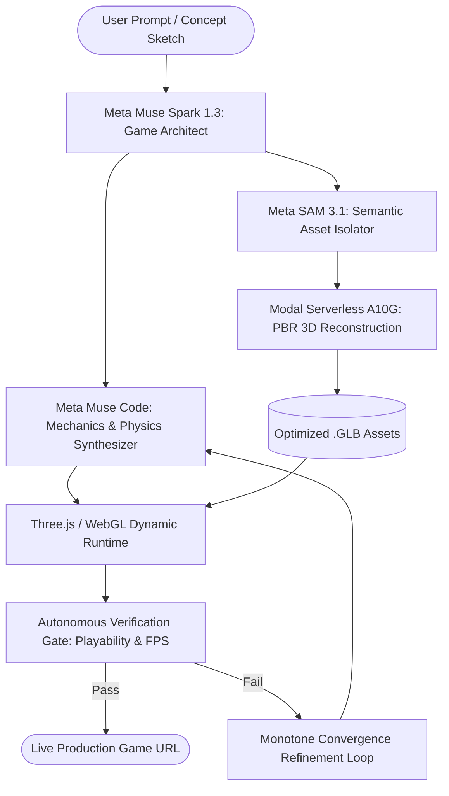

# 🎮 Agentic Game Studio

> **Autonomous Multimodal AI Agent Studio for Interactive 3D Worlds & Procedural Games**  
> _Built for the Meta Global AI Developer Hackathon 2026 ($1M Global AI Challenge)_

[](https://opensource.org/licenses/MIT)
[](https://dev.meta.ai/)
[-000000>)](https://modal.com/)
[](https://threejs.org/)

---

## 🌟 Overview

**Agentic Game Studio** is a next-generation autonomous software engineering agent that transforms high-level natural language concepts, visual sketches, and interactive rules into **fully playable, production-grade 3D games and spatial simulations** in under 90 seconds.

Traditional game development requires teams of 3D modelers, texture artists, physics programmers, and UI developers. Existing AI "game generators" produce either static 2D images or broken hallucinated scripts.

**Agentic Game Studio solves this bottleneck** with an end-to-end, multi-agent pipeline that unifies **Meta Muse multimodal reasoning**, **Meta SAM 3.1 computer vision**, and **Modal serverless GPU 3D reconstruction** into a verifiable, deterministic loop.

---

## 📐 System Architecture



### 1. 🧠 Orchestration & Mechanics (Meta Muse Spark & Muse Code)

- Generates robust game loops, state machines, and collision handling.
- Synthesizes responsive camera controls, mobile virtual joysticks, and desktop keyboard/mouse inputs.
- Eliminates hallucinations using a deterministic verification gate.

### 2. 👁️ Vision & Asset Segmentation (Meta SAM 3.1)

- Uses **Segment Anything Model (SAM 3.1)** to isolate objects from concept images with pixel-perfect alpha masking.
- Generates clean, centered orthographic views required for 3D reconstruction.

### 3. ⚡ Serverless 3D Asset Pipeline (Modal NVIDIA A10G)

- Serverless GPU worker spins up on-demand ($0 idle cost).
- Generates lightweight, watertight 3D meshes with UV unwrapping and PBR textures.
- Automatically exports production-ready `.glb` models optimized for real-time mobile and desktop web rendering.

### 4. 🎮 Universal 3D Runtime & Verification

- Cross-platform WebGL (Three.js) engine with zero-dependency loading.
- Native Unity 2022.3 LTS C# batch export compatibility.
- Built-in automated playability test harness measuring visual convergence, FPS stability, and touch responsiveness.

---

## 🚀 Key Features

- **Zero-to-Playable in <90 Seconds:** Generates game logic, 3D assets, audio, and UI in a single automated iteration.
- **True Cross-Platform:** Responsive HUD with multi-touch virtual joystick, gesture tracking, and adaptive screen scaling.
- **Serverless Zero-Idle Compute:** GPU resources scale down to zero when idle, consuming compute only during active generation.
- **Deterministic Quality Gate:** Self-healing loop that tests collision boundaries and framerates before production deployment.
- **100% Original & Compliant:** All assets are synthetically generated or open-source licensed (CC0/MIT) — zero trademarked IP, zero policy violations.

---

## 🛠️ Repository Structure

```
agentic-game-studio/
├── .github/                 # CI/CD verification workflows
├── src/
│   ├── agent/               # Meta Muse planning & orchestration logic
│   │   ├── planner.js       # Game design & mechanics decomposition
│   │   └── synthesizer.js   # Code synthesis & physics assembly
│   ├── pipeline/            # Modal serverless GPU & Meta SAM client
│   │   ├── sam_segment.py   # Meta SAM 3.1 background isolation
│   │   └── modal_gpu.py     # Serverless 3D mesh reconstruction
│   ├── runtime/             # Core 3D game engine & WebGL player
│   │   ├── engine.js        # Three.js scene, lighting & camera rig
│   │   ├── controls.js      # Dual-mode (mobile touch + keyboard/mouse)
│   │   └── physics.js       # Lightweight spatial collision system
│   └── verifier/            # Autonomous playability verification gate
│       ├── visual_check.js  # Headless render & pixel diff verification
│       └── fps_monitor.js   # Performance & memory stability monitor
├── examples/                # Pre-built procedural sample environments
├── package.json             # Scripts & dependency manifest
├── LICENSE                  # MIT License
└── README.md                # Project documentation
```

---

## ⚡ Quick Start

### Prerequisites

- Node.js 18+ / pnpm
- Python 3.10+
- Modal CLI (`pip install modal`)
- Meta Model API Key (`dev.meta.ai`)

### 1. Clone & Install

```bash
git clone https://github.com/shubham91150/agentic-game-studio.git
cd agentic-game-studio
pnpm install
```

### 2. Configure Environment

```bash
cp .env.example .env
# Add your META_API_KEY and MODAL credentials in .env
```

### 3. Generate a Game

```bash
# Generate an interactive 3D procedural world from a natural language prompt
node src/agent/generate.js --prompt "Futuristic neon cyber runner with dynamic obstacles and energy orbs"
```

---

## 🏆 Hackathon Alignment

- **Primary Track:** Indie Developer Track ($150,000 First Prize)
- **Target Problem Statement:** _Push the Frontier_ (giving autonomous AI agents real-world engineering and spatial 3D synthesis capabilities).
- **Target Bonus Awards:**
  - _Best Agentic Use-Case ($5,000)_: Multi-step autonomous planning, execution, and self-verifying refinement.
  - _Best Build on Meta Open Weight Models ($10,000)_: Meta SAM 3.1 + Muse Open weights served on serverless GPU infrastructure.
  - _Best Creative Build ($5,000)_: Creative AI synthesis combining multimodal vision and interactive 3D spatial environments.

---

## 📄 License

This project is licensed under the [MIT License](LICENSE).
