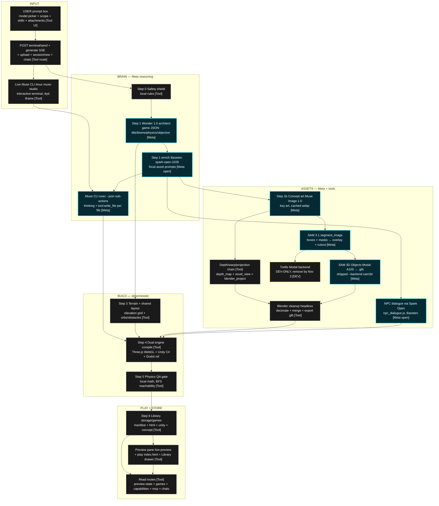

# PIPELINE — Agentic Game Studio, full picture

> Truth source (read, not invented): `src/agent/agent_runner.js` (Steps 0–6),
> `src/server.js` (routes), `src/tools/` (build-game, make-image, segment_image,
> depth_map, novel_view, blender_project, blender_cleanup, npc_dialogue,
> publish-game, modal_call_3d), `.agents/skills/` + `skills/`,
> `docs/WORLD_PIPELINE.md`, `REMINDERS.md` (trellis-dev vs sam3d-submission).

Legend: **[Meta]** = Meta model (hackathon-compliant) · **[Tool]** = open/local
tooling, never the shipped model path · **[DEV]** = dev-only, never ships.
Cyan border in the PNG = Meta · grey = tool/local · orange dashed = dev-only.

## Mermaid flowchart

## Route map (`src/server.js`)

| Route                                                              | Direction                                       | Stage      |
| ------------------------------------------------------------------ | ----------------------------------------------- | ---------- |
| `POST /api/studio/terminal/send`                                   | UI → live tmux (`/model` + prompt + refs)       | INPUT      |
| `POST /api/studio/generate` (SSE)                                  | streams phases/logs/cli/usage/proof/done        | BRAIN→PLAY |
| `POST /api/studio/upload`                                          | attachments → `storage/.uploads/` → CLI run dir | INPUT      |
| `POST /api/studio/session/new` + `GET /api/studio/chats[/:id]`     | fresh terminal, archived transcripts            | INPUT      |
| `GET /api/studio/preview-state` + `/studio/live-preview/*`         | Game Preview pane auto-reload (~2s)             | PLAY       |
| `GET /api/studio/games[/:id]` + `/studio/games/:id/index.html`     | Library drawer + play stored game               | PLAY       |
| `GET /api/studio/capabilities` + `GET/POST/DELETE /api/studio/mcp` | skills + MCP servers + models                   | INPUT      |
| `GET /api/studio/health`                                           | CLI present, Meta/Baseten keys, engines         | all        |

## Pipeline steps order (`agent_runner.js run()`)

0. Safety shield → 1. Wonder + Baseten design (cached) → 1b. Muse Image
   concept art (cached) → CLI writes `SPEC.md` + `AgenticPlayerController.cs`
   (cached) → 3. Terrain + layout → 4. Three.js + Unity compile → 5. QA gate →
1. Library save → `done` (gameId, playUrl, imageUrl, unitySource).

## ⚠️ Nov-3 Trellis → SAM3D swap (REMINDERS.md)

Dev/testing uses `ASSET_3D_BACKEND=trellis` (Microsoft TRELLIS on Modal).
Trellis is **NOT a Meta model** — shipping it breaks the Meta-models-only rule.
**By Nov 3:** set `ASSET_3D_BACKEND=sam3d` (Meta SAM 3D Objects) in VM env +
`startup.sh`, rebuild one asset end-to-end, then submit. After Nov 3,
`src/pipeline/assets_3d.js` prints a SUBMISSION BLOCKER warning on every
Trellis call. Pre-submit: `grep -rni trellis src/ public/` must show only
warnings/comments, zero live calls.

## Skills (`.agents/skills/` — composer capabilities)

`3d-web-experience` · `game-pipeline` · `game-logic` · `unity-build` ·
`godot-web` · `frontend-design` · `better-ui` · `better-interface` ·
`web-design-guidelines` · `mobile-design` · `ios-design` · `ui-taste` ·
`ui-ux-pro-max` (+ `skills/ios-design`, `skills/ui-taste` mirror).
Listed by `GET /api/studio/capabilities` alongside MCP servers + models.

## PNG

`docs/pipeline.png` — same pipeline drawn with PIL: dark `#000` bg,
white/grey boxes, cyan Meta accents, orange dashed dev-only box, staged in
columns INPUT → BRAIN → ASSETS → BUILD → PLAY.
